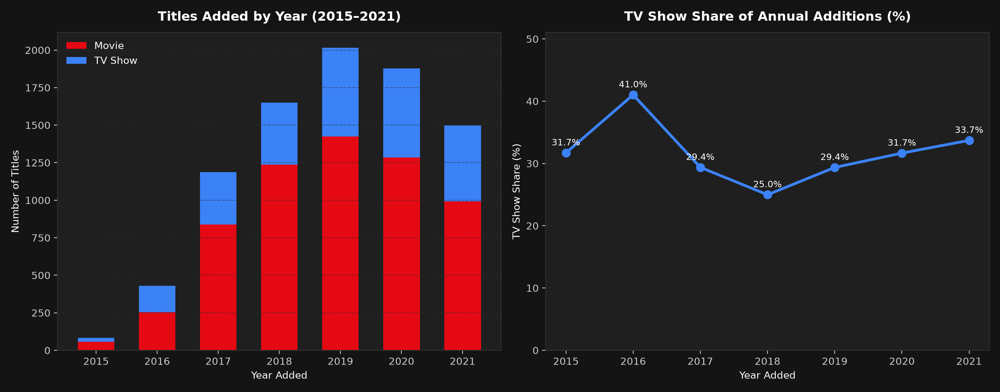
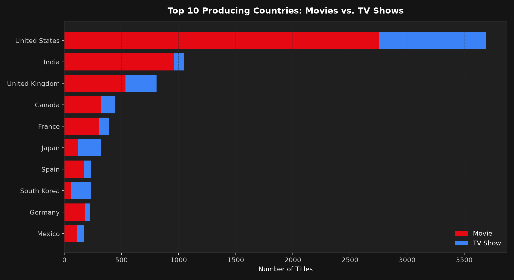
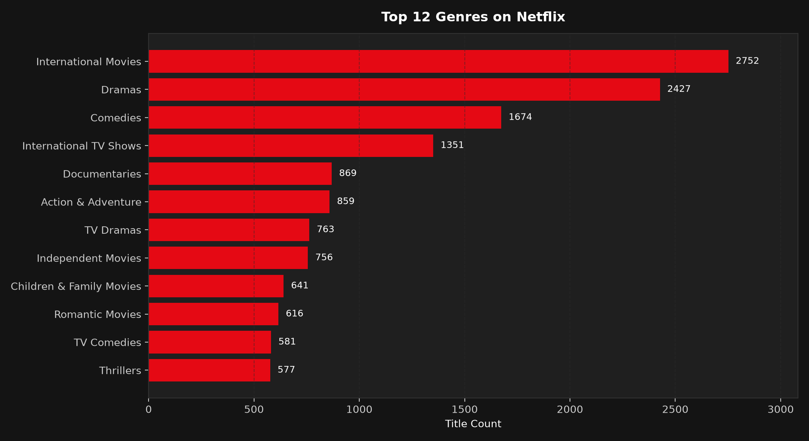
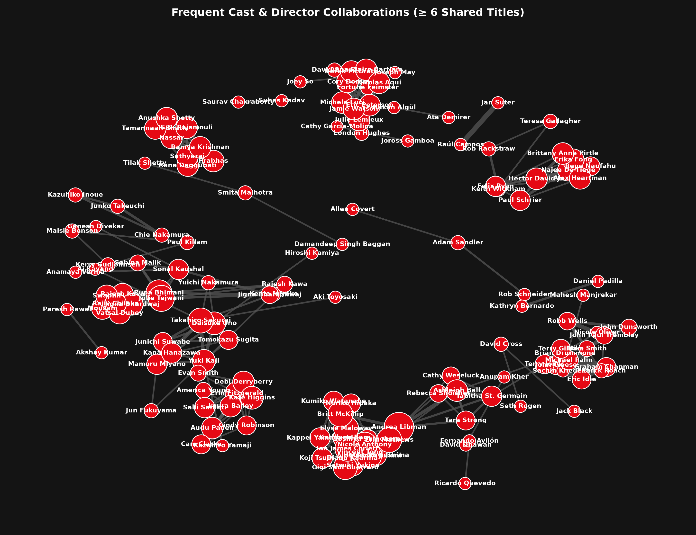

# Netflix Catalog Analytics, Content Recommender & Collaboration Network

An end-to-end exploratory data analysis, content-based recommendation engine, and cast/director network analysis built on the Netflix Movies and TV Shows dataset (`8,807` titles).

---

## Project Overview

This repository tackles four core analytical questions across the Netflix catalog:

1. **Geographic & Genre Distribution:** Explodes multi-country and multi-genre metadata to compare regional catalog volume and Movie-vs-TV-Show splits across top producing markets.
2. **Content-Based Similarity Engine:** Combines weighted metadata (`listed_in`, `director`, `cast`, `type`, `title`, and `description`) into a TF-IDF vector space and ranks similar titles via cosine similarity.
3. **Cast & Director Collaboration Network:** Constructs a weighted undirected graph in `NetworkX` to identify repeat creative partnerships, high-degree ensemble hubs, and bridge collaborators.
4. **Catalog Format Evolution (Movies vs. TV Shows):** Tracks annual additions (`date_added`) and percentage share shifts between Movies and TV Shows over time.

---

## Key Findings from the Dataset

* **Catalog Composition:** Out of **8,807** total titles, **69.62%** (`6,131`) are Movies and **30.38%** (`2,676`) are TV Shows.
* **Regional Format Splits:**
  * **United States** leads overall volume (`3,690` titles; `25.4%` TV Shows), followed by **India** (`1,046` titles; `8.0%` TV Shows) and the **United Kingdom** (`806` titles; `33.7%` TV Shows).
  * **South Korea** (`73.6%` TV Shows) and **Japan** (`62.6%` TV Shows) invert the global trend with series-dominated libraries.
* **Shift Toward TV Shows:** While total annual additions peaked in **2019–2020**, the **TV Show share** of newly added titles rose steadily from **25.0% (2018)** to **29.4% (2019)**, **31.7% (2020)**, and **33.7% (2021)**.
* **Collaboration Clusters:** The full cast/director graph spans **1,094 connected components**, revealing dense regional animation/voice-acting clusters (e.g., Julie Tejwani, Rupa Bhimani, Rajesh Kava, Rajiv Chilaka) alongside high-degree ensemble hubs led by Anupam Kher (`301` neighbors) and Samuel L. Jackson (`256` neighbors).

---

## Visual Outputs

| Annual Format Trend | Top Countries Split |
| :---: | :---: |
|  |  |

| Top Genres | Frequent Collaborator Network |
| :---: | :---: |
|  |  |

---

## Repository Structure

```text
netflixx/
├── data/
│   └── netflix_titles.csv          # Raw Kaggle dataset (8,807 titles)
├── outputs/
│   ├── 1_tv_vs_movie_trend.png
│   ├── 2_top_countries_split.png
│   ├── 3_top_genres.png
│   └── 4_collaboration_network.png
├── src/
│   ├── clean_eda.py                # Data cleaning, Parquet caching, country/genre & trend EDA
│   ├── recommender.py              # Weighted TF-IDF + cosine similarity recommender
│   ├── network_analysis.py         # NetworkX collaboration graph & centrality metrics
│   └── visualizations.py           # Dark-themed Matplotlib/Seaborn & NetworkX charts
├── .gitignore
├── requirements.txt
└── README.md


Quickstart
1. Set Up Environment
PowerShell
python -m venv .venv
.\.venv\Scripts\Activate.ps1
pip install -r requirements.txt
2. Run the Pipeline
PowerShell
# Clean data, cache Parquet, and print country/genre & annual trend tables
python src\clean_eda.py

# Run sample content-based similarity queries
python src\recommender.py

# Compute collaborator graph statistics and centrality rankings
python src\network_analysis.py

# Generate visual charts in outputs/
python src\visualizations.py
Tech Stack
Data Wrangling: pandas, numpy, pyarrow

NLP & Similarity Modeling: scikit-learn (TfidfVectorizer, cosine_similarity)

Graph Analytics: networkx

Visualization: matplotlib, seaborn